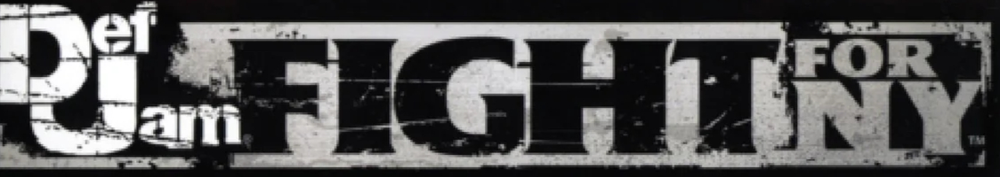

<p align="center">
  
</p>

<h1 align="center">defjam-sw</h1>

<p align="center">
  <b>Def Jam: Fight for NY</b> (Xbox, 2004) on the <b>Nintendo Switch</b> and Linux,<br>
  statically recompiled from the original Xbox executable — no emulator.
</p>

<p align="center">
  <a href="https://r-drg.github.io/defjam-sw-installer/"><b>Installer</b></a> ·
  <a href="https://github.com/R-drg/defjam-sw/releases"><b>Releases</b></a> ·
  <a href="#credits"><b>Credits</b></a>
</p>

The Xbox game's code is lifted instruction by instruction to C and built as a native program, with a runtime that
stands in for the Xbox kernel, its GPU (NV2A), its audio processor and its USB controllers. It follows
**[nfsu2-sw](https://github.com/antoxa2584x/nfsu2-sw)** by Anton Artemov, the Need for Speed: Underground 2 port this
one is built from, and the **[xboxrecomp](https://github.com/sp00nznet/xboxrecomp)** toolkit.

> [!IMPORTANT]
> **No game data is included.** You need your own copy of *Def Jam: Fight for NY* for the original Xbox
> (**USA** release, title ID `45410049`).

## What works

- Boot, the EA / THX logos and the intro movie, with sound
- The whole front end: user IDs and saves, options, Battle and Story menus
- **Battle**: One on One, Team and **Free for All with four fighters**, full matches with combos, Blazin' moves and the
  crowd
- **Story**: creating your fighter with the Sketch Artist (mugshot included), cutscenes, the crib, the map, the shops
  and the fights so far tested
- 60 fps in fights on the Switch; 4:3 picture as on the Xbox (16:9 stretch optional)

Not everything has been played through. Report what breaks with the log (see [Problems](#problems)).

## Installing on the Switch

You need a Switch running custom firmware (Atmosphère) with the Homebrew Menu, and your own copy of the game: the
disc image (`.iso`, a full dump or an xiso) or the extracted disc (the folder with `default.xbe`).

1. Open the **[installer](https://r-drg.github.io/defjam-sw-installer/)** in Chrome, Edge or Firefox on a computer.
   Choose your disc image or game folder. It checks that it is the supported release and saves
   **`defjam-sw.zip`**. Everything happens in your browser; your game files are never uploaded.
2. Extract the zip into the **`switch`** folder of your SD card. You get:

   ```
   sdmc:/switch/defjamx/
   ├── defjamx.nro         the game
   ├── defjamx_env.txt     settings (all optional)
   ├── LICENSES.txt
   └── game/               your disc's files (default.xbe, assets/, audio/, movies/, ...)
   ```
3. On the Switch, hold **R** while starting any installed game to open the Homebrew Menu in **title takeover** mode,
   and start **Def Jam: Fight for NY**. Applet mode (the Album) does not have enough memory.

Saves go to `sdmc:/switch/defjamx/game/UDATA/`.

<details>
<summary>Installing by hand</summary>

Download `defjamx.nro`, `defjamx_env.txt` and `LICENSES.txt` from the
[latest release](https://github.com/R-drg/defjam-sw/releases/latest) into `sdmc:/switch/defjamx/`, and copy every
file of the disc into `sdmc:/switch/defjamx/game/` (an xiso can be unpacked with
`python -m tools.xiso unpack` from `xboxrecomp/`, or extract-xiso). Copy with a card reader if you can: some MTP
tools skip folders without saying so.
</details>

## Controls

Buttons map by label: Switch **A/B/X/Y** are Xbox **A/B/X/Y**, **L/R** are the Xbox **White/Black** buttons,
**ZL/ZR** the triggers, **+** is Start and **−** is Back. Two controllers are players 1 and 2; the other fighters
in a Free for All are played by the game.

On Linux any SDL controller works, and the keyboard is player 1 without one: arrows (D-pad), Enter (Start), Backspace
or Esc (Back), Z / X / A / S (A / B / X / Y), Q / E (White / Black), 1 / 3 (triggers), numpad 8/4/2/6 (left stick),
I / J / K / L (right stick).

## Settings

`defjamx_env.txt`, next to the NRO, holds one `KEY=VALUE` per line. The file in the release lists them all,
commented out; the defaults are what the release was tested with. The useful ones:

| Setting | Effect |
|---|---|
| `DEFJAM_CPU_MHZ=1785`, `DEFJAM_GPU_MHZ=768`, `DEFJAM_MEM_MHZ=1600` | Raise the clocks while the game runs (smoother busy scenes, more heat and battery). |
| `RECOMP_WIDESCREEN=1` | Stretch the 4:3 picture to 16:9. |
| `RECOMP_GL_SCALE=1.5` | Render above the original 640×480 (costs GPU time). |
| `RECOMP_AUDIO_VOLUME=0..100` | Master volume. |
| `DEFJAM_GAME_DIR=...` | Game files somewhere other than `game/`. |

## Problems

The game writes `sdmc:/switch/defjamx/defjamx_log.txt`. Attach it to an
[issue](https://github.com/R-drg/defjam-sw/issues) with what you were doing; `RECOMP_QUIET=0` in the settings makes it
more detailed, `RECOMP_NX_PROFILE=1` adds a profile (`prof.bin`) for slowdowns.

## Building from source

<details>
<summary>Linux and Nintendo Switch</summary>

**0. Extract your disc** (Python 3 with capstone):

```sh
python3 -m venv .venv && .venv/bin/pip install capstone
cd xboxrecomp && ../.venv/bin/python -m tools.xiso unpack "/path/to/Def Jam - Fight for NY (USA).iso" -o ../game && cd ..
```

**1. Lift the executable to C** (`gen/`, about two minutes; never commit it):

```sh
tools/regen.sh                 # game/default.xbe -> gen/
LIFT_ONLY=1 tools/regen.sh     # after editing src/recomp_manual.c
```

**2a. Linux** (OpenGL; `-DDEFJAM_VULKAN=ON` for Vulkan):

```sh
sudo apt install cmake ninja-build pkg-config libsdl2-dev libgl-dev libepoxy-dev libssl-dev
cmake -S . -B build -G Ninja -DCMAKE_BUILD_TYPE=Release
cmake --build build
build/defjam_recomp            # reads ./game, or DEFJAM_GAME_DIR
```

**2b. Nintendo Switch** — with [devkitPro](https://devkitpro.org/wiki/Getting_Started) (`switch-dev switch-sdl2
switch-mesa`), or in its Docker image:

```sh
switch/build.sh                                  # stages switch_sd/switch/defjamx/ with your game
DOCKER=1 tools/release.sh                        # or: the release files in dist/, built in devkitpro/devkita64
```
</details>

## How it was made

`CLAUDE.md` is the engineering log: every fix, what broke and why, and the debugging switches. In short: the PTIMER
alarm the game's input clock runs on, the NV2A viewport constants, realistic memory statistics, a translator fix for
CPU flags at control-flow joins, the Sketch Artist's render target, palette texture caching for four-fighter matches,
and the Switch's lack of memory aliasing.

| Path | What |
|---|---|
| `src/main.c` | boot and runtime defaults (USB ports, APU, renderer) |
| `src/recomp_manual.c` | hand-written replacements for lifted functions |
| `src/switch_nx.c` | Switch layer: log, settings file, clocks, loading screen, profiler |
| `config/seed_functions.json` | entry points the static analysis cannot see |
| `xboxrecomp/` | the toolkit, vendored with nfsu2-sw's and this port's changes |
| `switch/` | Switch build script, settings template, licences shipped with the NRO |
| `tools/` | lifting, release, profiling and debugging tools |

## Credits

- **[nfsu2-sw](https://github.com/antoxa2584x/nfsu2-sw)** by **Anton Artemov
  ([@antoxa2584x](https://github.com/antoxa2584x))** — the port this one is modelled on and built from: the NV2A
  executor, the OpenGL and Vulkan renderers, the Switch platform layer, the audio and input paths, and the notes
  that made this port possible. Thank you.
- **[xboxrecomp](https://github.com/sp00nznet/xboxrecomp)** by **Ned Heller
  ([@sp00nznet](https://github.com/sp00nznet))** and its [contributors](xboxrecomp/CONTRIBUTORS.md) — the
  recompilation toolkit and Xbox runtime.
- **[xemu](https://github.com/xemu-project/xemu)** — the MCPX APU code and NV2A register definitions used by
  xboxrecomp (espes, Jannik Vogel, Matt Borgerson; LGPL-2.1).
- **StevensND** — [nfsmw-nx-installer](https://github.com/StevensND/nfsmw-nx-installer), the installer the
  [defjam-sw installer](https://github.com/R-drg/defjam-sw-installer) is adapted from.
- **[switchbrew](https://github.com/switchbrew/libnx)** and **[devkitPro](https://devkitpro.org)** — libnx and the
  toolchain; **[SDL](https://www.libsdl.org)** and **[Mesa](https://www.mesa3d.org)** for the Switch.
- Port by **Rodrigo Ferreira ([@R-drg](https://github.com/R-drg))**.

Details and licences: [NOTICE.md](NOTICE.md).

## Licence

This repository's code is MIT ([LICENSE](LICENSE)); `xboxrecomp/` is MIT with LGPL-2.1 parts listed in
`xboxrecomp/NOTICE`.

<sub>*Def Jam: Fight for NY* © 2004 Electronic Arts Inc., developed by AKI Corporation. This is an unofficial fan
project, not affiliated with or endorsed by Electronic Arts, AKI Corporation, Def Jam Recordings, Microsoft or
Nintendo. It contains no game data; you need your own copy of the game.</sub>
